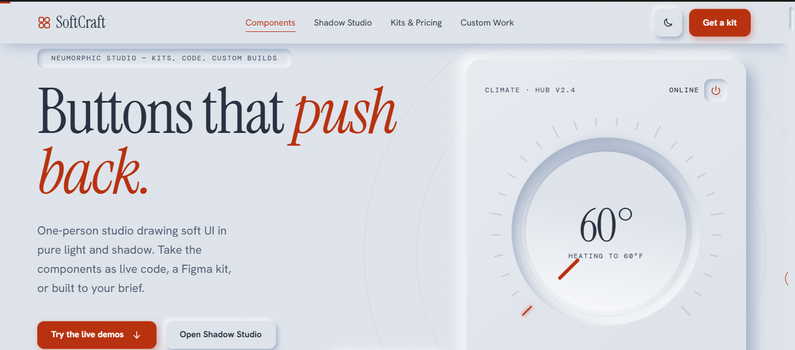
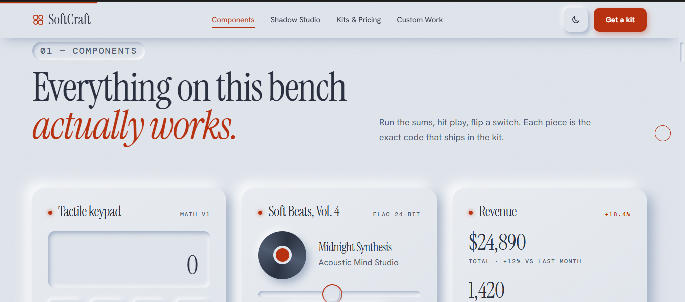
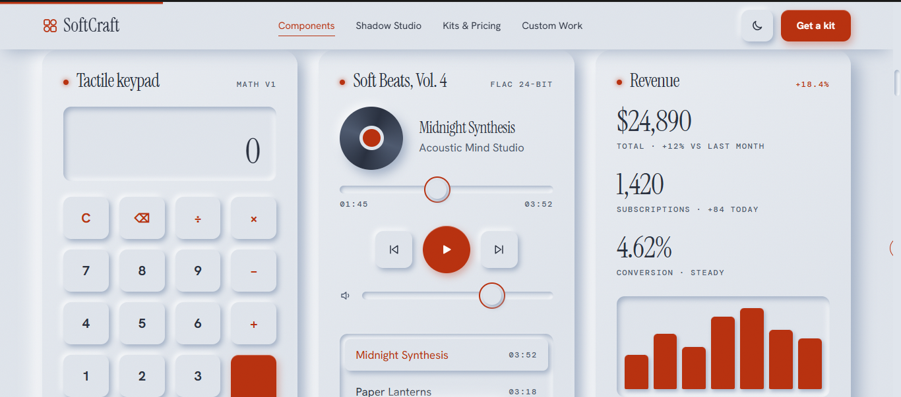
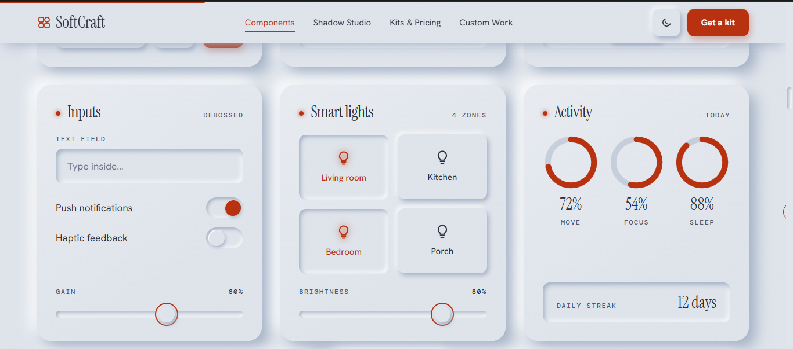
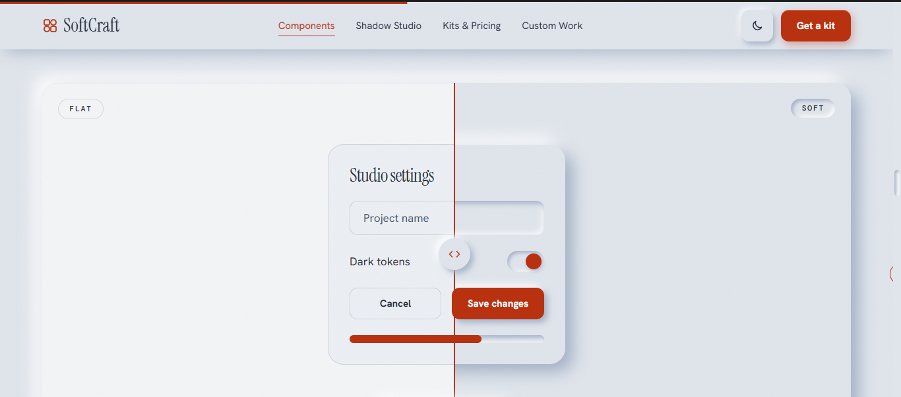
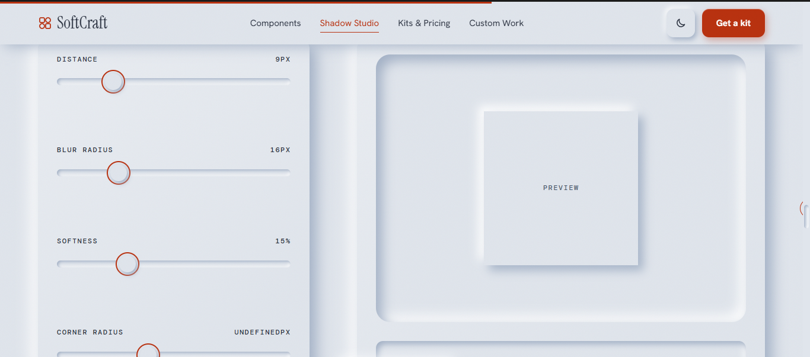
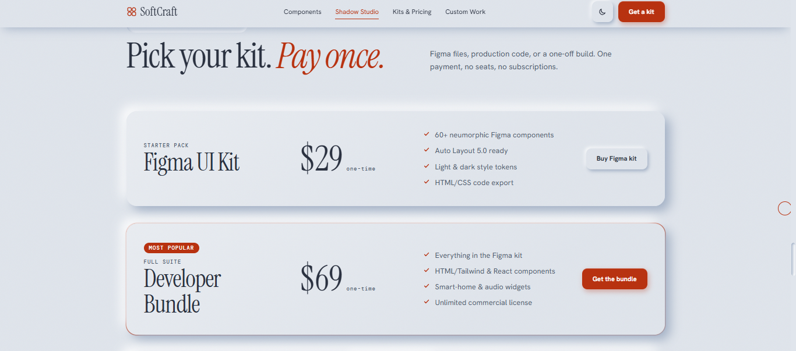
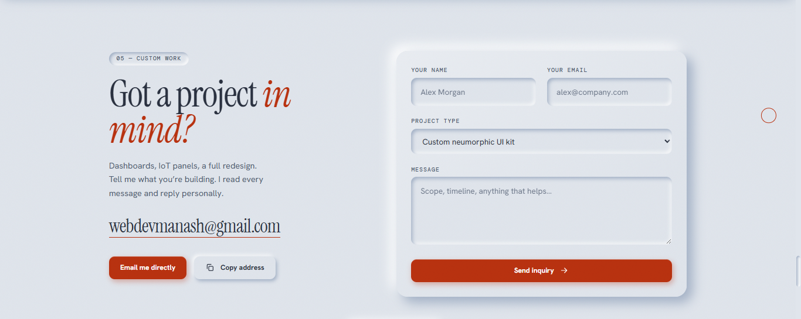

# SoftCraft — Neumorphic UI you can feel pressed

A one-person studio landing page built around **neumorphic (soft UI) components drawn purely in light and shadow**. It ships with a live component showcase, a before/after comparison, an interactive playground and a pricing section, all in plain HTML, CSS and JavaScript with no frameworks and no build step.

## Screenshots

| Hero | Components |
|:---:|:---:|
|  |  |
| **Tactile keypad, music player and revenue card** | **Inputs, smart lights and activity rings** |
|  |  |
| **Flat vs soft comparison** | **Shadow Studio playground** |
|  |  |
| **Pricing** | **Custom work and contact** |
|  |  |

## Features

- **Component showcase:** tactile keypad, music player, revenue card, inputs, smart lights, activity ring, calendar and selection controls
- **Flat vs soft:** a draggable divider comparing the same screen in both styles
- **Shadow Studio:** sliders for distance, blur, softness and corner radius with a live preview and copy-ready CSS
- **Pricing:** Figma UI Kit, Developer Bundle and Bespoke Design tiers
- **Contact section** for project enquiries
- **Light and dark themes** with a toggle; the choice is saved in `localStorage` and defaults to the system preference
- **Accessibility:** ARIA labels and states, live regions, visible focus rings and `prefers-reduced-motion` support
- **Responsive** layout with safe-area support for mobile devices
- **Zero dependencies** apart from Google Fonts

## Tech stack

| Layer | Details |
|---|---|
| Markup | Semantic HTML5 |
| Styling | CSS custom properties, `color-mix()`, layered shadows |
| Behaviour | Vanilla JavaScript (ES6+) |
| Fonts | Instrument Serif, Hanken Grotesk, DM Mono (Google Fonts) |

## Project structure

```
softcraft/
├── assets/
│   ├── css/
│   │   └── style.css
│   └── js/
│       └── main.js
├── docs/
│   └── screenshots/
├── index.html
├── LICENSE
└── README.md
```

## Getting started

No installation is needed.

```bash
# clone the repository
git clone <your-repo-url>
cd softcraft

# option 1: open index.html directly in your browser

# option 2: serve it locally
python3 -m http.server 8000
# then visit http://localhost:8000
```

## Design notes

Neumorphism only works when the background and the component surface are the **same colour**, so the whole page is built on one surface token. Depth comes from two shadows per element: a dark one (`--sd`) in the lower right and a light one (`--sl`) in the upper left. Pressed states invert them into inset shadows. Both themes redefine only these tokens, which is what makes the theme switch cheap.

## Deployment

It is a static site, so it deploys as-is to GitHub Pages, Netlify, Vercel or any static host. Point the host at the repository root.

## License

Released under the [MIT License](LICENSE).

## Author

Made by **Manash**.
